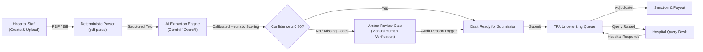

# ClaimFlow AI — Enterprise Cashless Claims & TPA Workspace

[](https://github.com/manoharnm/claimflow-ai)
[](https://nodejs.org)
[](https://www.typescriptlang.org)
[](LICENSE)

> **Problem Statement 3 — Mid-Size Hospital's Cashless Claims & TPA Workspace**  
> ClaimFlow AI is a production-style, role-governed healthcare SaaS platform that digitizes the end-to-end cashless insurance pre-authorization and adjudication workflow between mid-size hospitals and Third-Party Administrators (TPAs).

- **GitHub Repository**: [https://github.com/manoharnm/claimflow-ai](https://github.com/manoharnm/claimflow-ai)
- **Live Frontend App**: [https://claimflow-ai.vercel.app](https://claimflow-ai.vercel.app) *(Vercel)*
- **Live Backend API**: [https://claimflow-ai-api.onrender.com](https://claimflow-ai-api.onrender.com) *(Render)*
- **Technical Design Document**: [`docs/technical-design-document.md`](file:///c:/Users/Manohar%20NM/Downloads/claimflowai/docs/technical-design-document.md)
- **Deployment & Reviewer Guide**: [`docs/deployment.md`](file:///c:/Users/Manohar%20NM/Downloads/claimflowai/docs/deployment.md)

---

## 1. Quick Reviewer Demo Credentials

The platform features an instant **1-Click Demo Account Switcher** on the login page and top header.

| Role | Email | Password | Organization Scope |
| :--- | :--- | :--- | :--- |
| **Hospital Staff** | `hospital@claimflow.demo` | `HospitalStaff@2026!` | City Care Multispecialty Hospital |
| **TPA Manager** | `tpa@claimflow.demo` | `TPAManager@2026!` | HealthGuard TPA Services |

---

## 2. Key Problem Solved

Mid-size hospitals process hundreds of cashless insurance claims monthly across multiple TPAs (Star Health, Medi Assist, Niva Bupa, HDFC ERGO, ICICI Lombard). Legacy operations rely on WhatsApp, paper discharge summaries, fragmented billing printouts, and spreadsheets.

**Core Pain Points Solved**:
1. **Clinical Coding Deficits**: Missing ICD-10 and CPT codes are automatically extracted by AI and flagged for human review.
2. **Pre-Authorization Delays**: Multi-step structured digital claim registration replaces paper-based transcription.
3. **Missed TPA Query Deadlines**: Centralized SLA countdown timers ensure hospital billing desks never miss 24–48h query windows.
4. **Manual Scrutiny Errors**: Deterministic financial calculation engine detects line-item discrepancies against policy caps.
5. **No Auditable Traceability**: Cryptographic immutable audit logs track every state transition, field mutation, and financial approval.

---

## 3. Technology Stack

### Frontend
- **Framework**: React 18, Vite, TypeScript
- **Styling**: Tailwind CSS (Deep navy, clean white/slate surfaces, subtle teal accents)
- **State & Data Fetching**: TanStack Query (React Query v5)
- **Form Management & Validation**: React Hook Form, Zod
- **Icons & Data Visualization**: Lucide React, Recharts
- **Testing**: Vitest, React Testing Library, jsdom

### Backend
- **Runtime**: Node.js v22, Express.js, TypeScript (`tsx`)
- **Security & Middleware**: Helmet, CORS, Express-Rate-Limit
- **Authentication**: JWT (JSON Web Tokens), bcryptjs password hashing
- **Validation**: Zod runtime schema enforcement
- **Database & ODM**: MongoDB Atlas, Mongoose v8
- **Document Text Extraction**: `pdf-parse` (deterministic PDF parser)
- **AI Extraction Engine**: Google Gemini API (`gemini-3.5-flash-lite`) / OpenAI (`gpt-4o-mini`)
- **Testing**: Vitest, Supertest, MongoMemoryServer

---

## 4. Core Architecture & Workflow



---

## 5. Claim State Machine Lifecycle

The platform enforces a strict, deterministic backend state machine:
- `DRAFT` &rarr; `SUBMITTED` &rarr; `TPA_REVIEW`
- `TPA_REVIEW` &harr; `QUERY_RAISED` (SLA timer active)
- `TPA_REVIEW` &rarr; `APPROVED` &rarr; `SANCTIONED` &rarr; `SETTLED`
- `TPA_REVIEW` &rarr; `REJECTED` (Mandatory rejection reason required)

---

## 6. AI Uncertainty Handling & Human-in-the-Loop (HITL)

ClaimFlow AI never fabricates confidence scores or treats raw LLM self-reported confidence as ground truth:
1. **Calibrated Confidence**: Confidence is deterministically derived from:
   - Text evidence grounding (verbatim tokens in extracted document text)
   - ICD-10 / CPT / Policy number regex format validation
   - Document length and OCR readability score
2. **Threshold Enforcement (0.80)**:
   - Any field scoring `< 0.80` is marked as **uncertain** and highlighted in yellow.
   - Missing mandatory fields (Primary ICD-10 code, Clinical diagnosis, Policy Number) lock the claim from submission.
3. **Manual Override with Immutable Audit Logging**:
   - Hospital staff can manually verify/correct any field.
   - Requires entering a mandatory clinical justification (e.g. *"Verified with attending physician Dr. Sen against physical discharge record"*).
   - The original AI value is preserved alongside the human-verified value.
4. **Service Fallback**:
   - If no AI API key is configured or the external LLM is unreachable, the system displays an `AI_SERVICE_UNAVAILABLE` banner and presents a controlled manual-review path without crashing or pretending extraction succeeded.

---

## 7. Local Quick Start

### 1. Prerequisites
- Node.js v18+ (tested on v22.19.0)
- npm v9+

### 2. Setup Server
```bash
cd server
npm install
cp .env.example .env
# Edit .env with your MongoDB Atlas URI or leave default for memory/local
npm run seed     # Seeds 2 demo users and 12 realistic claims
npm run dev      # Starts API on http://localhost:5000
```

### 3. Setup Client
```bash
cd client
npm install
npm run dev      # Starts Vite on http://localhost:5173
```

### 4. Run Automated Tests
```bash
# Server integration tests (20 tests)
cd server
npm test

# Client UI tests (4 tests)
cd client
npm test
```

---

## 8. Seeded Demo Data Summary

The seed script (`npm run seed`) populates:
- **2 Active Demo Accounts**:
  - `hospital@claimflow.demo` (Billing Lead, City Care Hospital)
  - `tpa@claimflow.demo` (Senior Adjudicator, HealthGuard TPA)
- **12 Realistic Cashless Claims** across:
  - Star Health, Medi Assist, Niva Bupa, HDFC ERGO, ICICI Lombard
- Varied clinical cases: STEMI Angioplasty, Laparoscopic Cholecystectomy, Total Knee Arthroplasty, Appendicitis, Maternity Delivery, Inguinal Hernia, Cataract, Dengue.
- Varied lifecycle states: `DRAFT`, `SUBMITTED`, `TPA_REVIEW`, `QUERY_RAISED`, `APPROVED`, `SANCTIONED`, `SETTLED`, `REJECTED`.
- Active 24-hour TPA clarification queries with pending deadlines.
- Complete regulatory audit trail events.

---

## 9. Security & Compliance

- **HTTP Security**: Helmet headers, CORS origin allowlisting, rate limiting on `/api/auth/login`.
- **Stateless RBAC**: JWT authorization tokens validated at route level on all protected endpoints.
- **Passwords**: Salted and hashed using `bcryptjs` (10 rounds).
- **Validation**: Strict Zod schema parsing on all request payloads.
- **Audit Logging**: Immutable event ledger capturing timestamps, actor IDs, previous states, and justifications.
- **Clean Hygiene**: Zero secrets or credentials committed; `.gitignore` covers `.env`, uploads, build caches, and node_modules.

---

## 10. License
ClaimFlow AI is open-source software licensed under the [MIT License](LICENSE).

