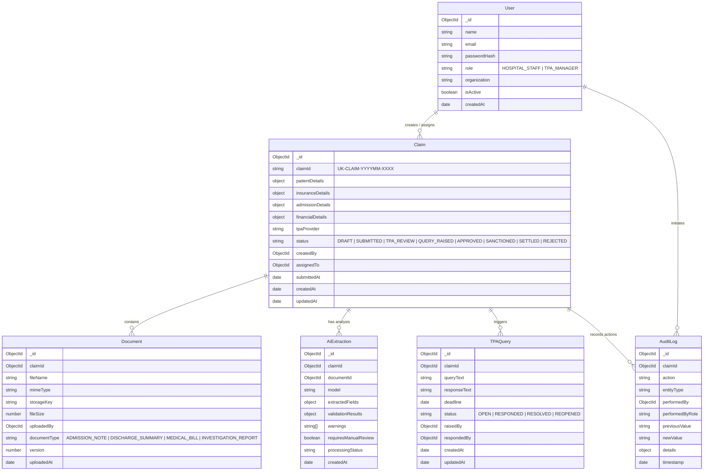
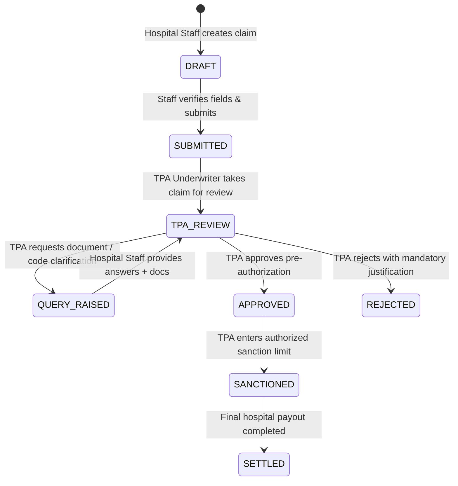

# Technical Design Document — ClaimFlow AI
**Enterprise Hospital Cashless Insurance Claims & TPA Management Workspace**

- **GitHub Repository**: [https://github.com/manoharnm/claimflow-ai](https://github.com/manoharnm/claimflow-ai)
- **Live Frontend Application**: [https://claimflow-ai.vercel.app](https://claimflow-ai.vercel.app) *(Deployment target: Vercel)*
- **Live Backend API**: [https://claimflow-ai-api.onrender.com](https://claimflow-ai-api.onrender.com) *(Deployment target: Render)*

---

## 1. Problem Statement & Context

### 1.1 Context
Mid-size hospitals face operational bottlenecks when processing cashless health insurance claims across multiple Third-Party Administrators (TPAs) such as Star Health, Medi Assist, Niva Bupa, HDFC ERGO, and ICICI Lombard. The legacy operating model relies on fragmented communication channels: ad-hoc emails, WhatsApp threads, physical paper discharge summaries, fragmented billing printouts, and unstructured spreadsheets.

### 1.2 Core Challenges
1. **Clinical Coding Deficits**: Missing or inaccurate ICD-10 (diagnosis) and CPT/procedure codes result in repeated claim rejections and delays.
2. **Pre-Authorization Latency**: Hospital desks spend hours transcribing physical admission records, causing delayed pre-authorizations and patient distress.
3. **Missed TPA Query Deadlines**: TPAs raise strict 24–48 hour clarification queries. Without centralized tracking, deadlines elapse, converting cashless claims into out-of-pocket patient liabilities.
4. **Manual Document Scrutiny**: High cognitive load on claim handlers manually comparing multi-page discharge summaries against hospital pharmacy and procedure bills.
5. **Financial Reconciliation Gaps**: Disconnect between initial estimated costs, claimed amounts, and authorized sanction caps.
6. **No Auditable Traceability**: Lack of tamper-proof audit trails for legal and regulatory compliance.

### 1.3 Solution Objective
ClaimFlow AI is an enterprise-grade, role-governed healthcare SaaS platform that digitizes and orchestrates the cashless claim lifecycle. It bridges hospital billing desks and TPA underwriters with AI-assisted document parsing, automated financial validation, field-level uncertainty scoring, and a deterministic state machine.

---

## 2. System Architecture & Justification

### 2.1 High-Level Architecture

```mermaid
flowchart TB
    subgraph ClientLayer ["Client Layer (React 19 + TypeScript + Vite + Tailwind CSS)"]
        HospApp["Hospital Staff Workspace<br/>(Claims, Admissions, Bills, Query Desk)"]
        TpaApp["TPA Reviewer Portal<br/>(Queue, Adjudication, Query Management)"]
        SharedUI["Enterprise Design System<br/>(Cards, Modals, Badges, Timelines)"]
    end

    subgraph APILayer ["Backend API Layer (Node.js + Express + TypeScript)"]
        AuthMid["JWT & RBAC Middleware"]
        ValMid["Zod Request Validation"]
        RateMid["Rate Limiter & Helmet Security"]
        
        subgraph Controllers ["Controllers & Route Handlers"]
            AuthCtrl["Auth Controller"]
            ClaimCtrl["Claim Controller"]
            DocCtrl["Document Upload Controller"]
            AICtrl["AI Extraction Controller"]
            QueryCtrl["Query Controller"]
            AuditCtrl["Audit Log Controller"]
        end
        
        subgraph EngineCore ["Core Business Engines"]
            StateMachine["Claim Lifecycle State Machine"]
            FinCalc["Financial Validation Engine (INR)"]
            DocParser["Document Parsing Engine (PDF/OCR)"]
            AIEngine["Gemini/OpenAI Structured JSON Pipeline"]
            ConfidenceEngine["Calibrated Uncertainty & Heuristics"]
        end
    end

    subgraph DataLayer ["Data & Storage Layer"]
        MongoDB[("MongoDB Atlas (Mongoose ODM)")]
        LocalDisk[("Secure Local Storage / Encrypted Bucket")]
    end

    HospApp -->|REST / JSON| APILayer
    TpaApp -->|REST / JSON| APILayer
    APILayer --> MongoDB
    DocCtrl --> LocalDisk
    AIEngine -->|Generative AI API| ExternalLLM["Google Gemini / OpenAI API"]
```

### 2.2 Architecture Justification
- **Frontend (Vite + React + TypeScript + Tailwind CSS)**:
  - Fast HMR, type safety, and zero-runtime CSS footprint with Tailwind.
  - TanStack Query (React Query) handles cache invalidation, background refetching, optimistic mutations, and resilient error states.
  - Lucide icons, Recharts for financial analytics, and custom modular UI components match modern enterprise medical record systems (Epic/Cerner/AthenaHealth style).
- **Backend (Node.js + Express + TypeScript)**:
  - Predictable asynchronous I/O ideal for handling document uploads, multipart parsing, and multi-second LLM streaming/completion requests.
  - Strict compile-time typing with TypeScript guarantees schema coherence between request payloads, internal domain models, and database contracts.
- **Database (MongoDB Atlas with Mongoose)**:
  - Flexible document model perfectly accommodates varied clinical document extractions, nested financial breakdowns, dynamic bill components, and multi-turn query timelines without brittle relational schema migrations.
  - Compound indexes on `claimId`, `status`, `tpaProvider`, and `createdAt` ensure sub-millisecond query responses.
- **AI Integration (Google Gemini 3.5 Flash Lite / OpenAI with Structured Output)**:
  - Strict JSON schema enforcement eliminates parser hallucinations.
  - Document text extracted via deterministic PDF text parsers is analyzed alongside clinical guidelines for ICD-10 and CPT coding.
  - Dual-layer confidence engine prevents hallucinated LLM confidence from bypassing human oversight.

---

## 3. Database Models & Entity Relationship

---

## 4. Role-Based Access Control (RBAC) Matrix

| Action / Capability | Hospital Staff (`HOSPITAL_STAFF`) | TPA Manager (`TPA_MANAGER`) | Backend Guard Rule |
| :--- | :---: | :---: | :--- |
| **Create & Edit Draft Claims** | Full Access | Denied (403) | Only `HOSPITAL_STAFF` on `DRAFT` status |
| **Upload Clinical & Billing Docs** | Full Access | Denied (403) | Only `HOSPITAL_STAFF` |
| **Trigger AI Extraction** | Full Access | Read-Only | Runs on upload or re-scan |
| **Perform Manual AI Override** | Full Access | Read-Only | Must supply reason; writes to AuditLog |
| **Submit Pre-Auth Request** | Allowed | Denied (403) | Requires all mandatory fields verified |
| **Adjudicate (Approve/Sanction)** | Denied (403) | Full Access | Only `TPA_MANAGER` |
| **Reject Claim** | Denied (403) | Full Access | Requires non-empty mandatory reason |
| **Raise Query & Set Deadline** | Denied (403) | Full Access | Only `TPA_MANAGER` |
| **Respond to Query** | Full Access | Denied (403) | Only `HOSPITAL_STAFF` on `QUERY_RAISED` |
| **Resolve / Reopen Query** | Denied (403) | Full Access | Only `TPA_MANAGER` |
| **Settle Claim** | Denied (403) | Full Access | Requires `SANCTIONED` status |
| **View Immutable Audit Logs** | Read-Only | Read-Only | No user modification permitted |

---

## 5. Claim Lifecycle & State Machine

### Deterministic State Guards
1. `DRAFT -> SUBMITTED`: Prohibited if any mandatory field is uncertain (`confidence < 0.80`) without human verification tag.
2. `SUBMITTED -> TPA_REVIEW`: Can only be initiated by a user with `TPA_MANAGER` role.
3. `TPA_REVIEW -> QUERY_RAISED`: Requires a valid future deadline date and query description.
4. `QUERY_RAISED -> TPA_REVIEW`: Requires a non-empty hospital response.
5. `TPA_REVIEW -> APPROVED`: Validates that approved amount > 0 and <= claimed amount (unless explicit exception documented).
6. `APPROVED -> SANCTIONED`: Confirms final sanction amount in INR within policy coverage limit.
7. `SANCTIONED -> SETTLED`: Confirms hospital settlement confirmation.
8. `TPA_REVIEW -> REJECTED`: Requires mandatory rejection reason.

---

## 6. AI Extraction Pipeline & Uncertainty Handling

### 6.1 Extraction Pipeline
1. **Document Ingestion**: File type validation (PDF, PNG, JPG), max 15MB, virus/integrity check, safe disk storage.
2. **Deterministic Preprocessing**: PDF text extraction via `pdf-parse`; extraction of metadata, tables, and raw text lines.
3. **LLM Prompting with Structured Schema**: Invocation of configured model (Google Gemini / OpenAI) with strict JSON schema instructions:
   - Patient Name, Gender, Age.
   - Policy Number, TPA Provider.
   - Admission & Discharge Date.
   - Diagnosis text, Primary ICD-10 Code, Secondary ICD-10 Codes.
   - Clinical Procedures, CPT Codes.
   - Itemized Bill (Room charges, Surgery/Doctor fees, Pharmacy, Diagnostics, Taxes).
   - Total Claimed Amount.
4. **Calibrated Confidence Scoring**:
   - Instead of trusting raw LLM self-reported confidence, a multi-factor heuristics engine scores each extracted field:
     $$\text{Confidence Score} = w_1 \cdot \text{RegexExactMatch} + w_2 \cdot \text{TextEvidenceOverlap} + w_3 \cdot \text{FormatValidity} + w_4 \cdot \text{Completeness}$$
   - **Confidence Threshold**: Default set to **0.80**.
   - If any field scores below 0.80, `requiresManualReview` is flagged as `true`.

### 6.2 Human-in-the-Loop (HITL) Review Flow
- Uncertain fields are highlighted in the UI with amber/yellow badges and explanatory tooltips.
- Hospital Staff can edit any field before submission.
- Manual edit dialog requires entering:
  - Corrected value.
  - Reason for correction (e.g. *"Doctor handwriting clarified with attending physician"*).
- System stores:
  - `aiValue`: Original extracted text and initial score.
  - `verifiedValue`: Human-confirmed value.
  - `verifiedBy`: User ID and role.
  - `verifiedAt`: ISO timestamp.
  - `isVerified`: `true`.
- Audit Log automatically captures the mutation.

### 6.3 External AI Service Failure & Fallback
- If the AI API key is missing or the external service times out:
  - The system returns an explicit `AI_SERVICE_UNAVAILABLE` status.
  - Extraction record is preserved with `processingStatus: "FAILED"`.
  - A controlled manual data entry mode is made available to staff.
  - System never fabricates mock AI extractions or hides failure.

---

## 7. Financial Validation Engine (INR)

All financial figures are strictly calculated and stored in **Indian National Rupees (INR)**.

### Calculation Rules:
1. **Total Bill Aggregation**:
   $$\text{Calculated Total} = \text{Room} + \text{Procedures} + \text{Medicine} + \text{Investigations} + \text{Other Charges}$$
2. **Discrepancy Checks**:
   - If $|\text{Claimed Amount} - \text{Calculated Total}| > 1$, flag discrepancy warning.
   - If $\text{Claimed Amount} > \text{Policy Limit}$, calculate and display **Exceeding Coverage Amount**.
3. **Approved Amount Invariants**:
   - $\text{Approved Amount} \le \text{Claimed Amount}$.
   - $\text{Approved Amount} \le \text{Policy Limit}$.
   - Difference $\Delta = \text{Claimed Amount} - \text{Approved Amount}$ (Co-pay / Non-admissible deduction).
   - Negative amounts are rejected at schema validation level.

---

## 8. Security & Compliance Architecture

- **Defense-in-Depth**:
  - `helmet`: Secure HTTP headers (CSP, HSTS, X-Content-Type-Options, etc.).
  - `cors`: Strict origin allowlisting for client domains.
  - `express-rate-limit`: Sensitive authentication endpoints capped at 10 requests / 15 minutes to thwart brute-force attempts.
  - `bcrypt`: Password salting and hashing with 10 rounds.
  - `jsonwebtoken`: Stateless, cryptographically signed tokens with 8-hour expiry.
  - `zod`: Strong runtime request payload validation across every REST endpoint.
- **Data Protection & Sanitization**:
  - File upload restrictions: restricted mime types (`application/pdf`, `image/png`, `image/jpeg`).
  - Filename sanitization preventing path traversal attacks (`../`).
  - No secrets in git or client bundles; environment variables loaded through validated config module.

---

## 9. Testing & Quality Assurance Strategy

- **Unit & Integration Suite**:
  - Vitest test runner paired with Supertest for API integration.
  - Tests verify:
    1. Authentication & JWT validation (valid/invalid credentials, token expiry, inactive accounts).
    2. Role-Based Access Control guards (Hospital Staff cannot approve claims, TPA cannot modify medical docs).
    3. Claim State Machine transitions (prohibits invalid jumps, e.g., DRAFT to APPROVED).
    4. Financial calculations & policy cap logic.
    5. AI extraction parser, confidence threshold evaluator, and manual override audit recording.
    6. External AI failure fallback graceful handling.

---

## 10. Scope Trade-Offs & Future Enhancements

- **Phase 1 (Current Scope)**:
  - Dual-role enterprise workspace (Hospital Staff & TPA Manager).
  - Multi-step claim creation with dynamic bill itemization.
  - Real document upload with text parsing and LLM structured extraction.
  - Field-level uncertainty detection and mandatory review gate.
  - Full TPA adjudication workflow (queries, deadlines, approvals, sanctions, rejections).
  - Comprehensive immutable audit trail.
  - Seed dataset with 10+ realistic claims and demo accounts.
- **Future Enhancements**:
  - Direct ABDM (Ayushman Bharat Digital Mission) FHIR API integration for digital health records.
  - Real-time WebSockets / SSE for push notifications on query deadlines.
  - Multi-hospital multi-tenancy with hospital administrator management.

